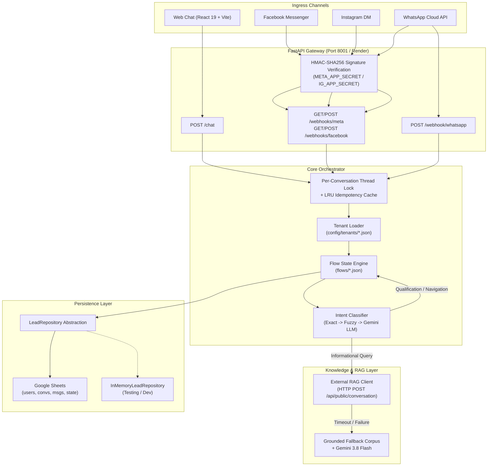

# Omnichannel Conversational Lead Bot — Project Handoff Documentation

**Project Name:** Omnichannel Conversational Lead Bot  
**Backend Directory:** `D:\Omnichannel Conversational Lead Bot-backend`  
**Frontend Directory:** `D:\Omnichannel Conversational Lead Bot-backend\frontend`  
**Date:** October 9, 2026  
**Status:** Core engine fully functional (259/259 tests passing); Meta App pending security checkpoint clearance.

---

## 1. Executive Summary

The **Omnichannel Conversational Lead Bot** is an enterprise-grade, multi-tenant lead generation and customer qualification platform. It engages inbound prospects across multiple messaging channels, automates initial discovery, answers company and technical questions via Retrieval-Augmented Generation (RAG), qualifies project requirements, and books discovery calls or initiates human handoffs.

### Key Capabilities
- **Omnichannel Ingress:** Single unified conversational experience across **Web Chat**, **Facebook Messenger**, **Instagram DM**, and **WhatsApp Business**.
- **Multi-Tenant Architecture:** Fully decoupled business logic driven by tenant JSON configurations and JSON flow state machines. Zero code changes required to onboard new clients.
- **Hybrid Intent Engine:** Blends deterministic regex matching, alias maps, fuzzy matching, and Google Gemini semantic classification with strict priority rules (buying intent always supersedes generic info queries).
- **RAG Knowledge Layer:** Integrated with external OrionSoft RAG microservices, backed by a local grounded fallback corpus with circuit-breaker protection, timeouts, and safe responses.
- **State & Data Persistence:** Seamless persistence to Google Sheets (`users`, `conversations`, `messages`, `conversation_state`) with row-index caching and in-memory mock repository for local development and CI testing.
- **Enterprise Resilience:** Per-conversation thread locking, bounded LRU idempotency cache for webhook retries, automated token refresh daemons, and signature validation.

---

## 2. System Architecture



---

## 3. Ingress Channels & Adapters

All channel adapters inherit from unified base classes in `app/channels/`, ensuring consistent option formatting, character truncation, and error handling.

| Channel | Protocol & API | Payload Format / Interactive Controls | Adapter File |
| :--- | :--- | :--- | :--- |
| **Web Chat** | HTTP `POST /chat` | Standard JSON (`reply`, `options[]`). React 19 client with automatic session ID and retry logic. | `app/api/chat.py`<br>`frontend/src/` |
| **Facebook Messenger** | Meta Graph API `v20.0`/`v21.0`<br>`POST /me/messages` | Text chunks ($\le 2000$ chars) + Quick Replies ($\le 13$ options). Paged menus with *"More options"* and graceful text fallback if rejected. | `app/channels/facebook.py`<br>`app/channels/base.py` |
| **Instagram DM** | Instagram Graph API<br>`graph.instagram.com/v20.0/me/messages` | Text chunks ($\le 1000$ chars) + Quick Replies ($\le 13$ options). Includes auto-refresh background task for 60-day `IGAA` tokens. | `app/channels/instagram.py`<br>`app/channels/instagram_token.py` |
| **WhatsApp Business** | WhatsApp Cloud API<br>`POST /{phone_id}/messages` | $\le 3$ options: Interactive Reply Buttons.<br>$> 3$ options: Interactive List Menu ($\le 10$ rows, sections). Plain text fallback. Customer phone masking in logs. | `app/channels/whatsapp.py` |

### Security & Signature Verification
- Inbound webhooks on `/webhooks/meta` and `/webhooks/facebook` require valid `X-Hub-Signature-256` matching `META_APP_SECRET` (or `IG_APP_SECRET` for Instagram Login webhooks).
- Webhook registration verifies `hub.mode=subscribe` against `META_VERIFY_TOKEN`.
- Secrets, access tokens, and personal customer data (phone numbers) are strictly masked or redacted from logging.

---

## 4. Conversation Flow & Qualification Engine

The conversation logic in [`app/services/orchestrator.py`](file:///D:/Omnichannel%20Conversational%20Lead%20Bot-backend/app/services/orchestrator.py) executes a 10-tier routing priority:

1. **Tenant Validation & Flow Resolution:** Resolves active tenant from payload.
2. **Global Navigation Commands:** Immediate intercepts for `hi`, `hello`, `main menu`, `restart`, `back`, `0`.
3. **Exact Step Option:** Matches button IDs or displayed labels for the active flow step.
4. **Global Flow Options:** Matches universal labels (e.g., *"Talk to Team"*, *"Pricing & Estimates"*).
5. **Special Step Capture:** Extracts freeform text for slots (`requirements`, `timeline`, `booking_slot`, `contact_info`).
6. **Deterministic Intent:** Regex and alias detection for services, pricing questions, portfolio, and human handoff.
7. **Semantic Option Matching:** Google Gemini evaluates ambiguous user text against current choices.
8. **Semantic Global Intent:** Google Gemini categorizes user requests into flow targets.
9. **RAG Knowledge Base Query:** Answers company questions if the tenant has an active knowledge base.
10. **Safe Clarification:** Keeps the user's current step context and provides recovery actions.

### Core Qualification Data Captured
State is tracked per conversation in the `conversation_state` table:
- `service` (e.g., Website Development, Mobile App, AI & Automation)
- `sub_service` (e.g., New Website, Website Redesign, Custom Platform)
- `requirements` (Extracted project scope)
- `timeline` (Expected timeframe: 2-4 weeks, 1-2 months, etc.)
- `budget` (Detected monetary amounts or tiers)
- `contact_info` / `email` / `phone` / `name`
- `booking_slot` (Scheduled consultation preference)

> [!IMPORTANT]
> **Buying Intent Priority:** If a prospect says *"I want a RAG chatbot for our internal documents"*, the bot does not just output a generic informational definition from RAG. It routes immediately to the **AI Chatbot / RAG Chatbot requirement capture flow**.

---

## 5. RAG Knowledge Layer

Located in [`app/services/knowledge_service.py`](file:///D:/Omnichannel%20Conversational%20Lead%20Bot-backend/app/services/knowledge_service.py).

### How It Operates
1. **Multi-Tenant Configuration:** Defined in tenant config (`config/tenants/client_001.json`):
   ```json
   "rag": {
     "enabled": true,
     "base_url_env": "RAG_API_BASE_URL",
     "endpoint": "/api/public/conversation",
     "timeout_seconds": 10.0
   }
   ```
2. **External Microservice Query:** Sends `{ "question": "..." }` to the external OrionSoft RAG API.
3. **Suggested Queries Integration:** Inspects `suggested_queries` or `suggested_questions` and converts up to 2 high-relevance items into clickable options alongside `["Ask Another Question", "Talk to Team", "Main Menu"]`.
4. **Resilience & Fallback:**
   - If the external API times out or errors (HTTP 4xx/5xx), it falls back to a **local grounded knowledge corpus** evaluated by Gemini 3.8 Flash.
   - If the question is outside the business domain, it returns:
     > *"I'm not completely sure about that based on the information available in our knowledge base. I can help you clarify your requirement or connect you with our team."*
   - Preserves all qualification variables in conversation state during RAG queries.

---

## 6. Persistence & Storage (Google Sheets)

The repository abstraction is defined in [`app/repositories/base.py`](file:///D:/Omnichannel%20Conversational%20Lead%20Bot-backend/app/repositories/base.py):

| Worksheet | Columns Tracked |
| :--- | :--- |
| **`users`** | `tenant_id`, `user_id`, `name`, `phone`, `email`, `channel`, `created_at` |
| **`conversations`** | `tenant_id`, `conversation_id`, `user_id`, `channel`, `status`, `started_at`, `updated_at` |
| **`messages`** | `tenant_id`, `message_id`, `conversation_id`, `sender`, `message`, `timestamp`, `client_message_id` |
| **`conversation_state`** | `tenant_id`, `conversation_id`, `current_flow`, `current_step`, `intent`, `status`, `updated_at`, `service`, `sub_service`, `service_key`, `requirements`, `timeline`, `budget`, `name`, `email`, `phone`, `existing_url`, `platform`, `booking_slot`, `contact_info` |

### Key Optimizations
- **Background Warmup:** `repo.warm_up()` runs in a daemon thread on application startup, ensuring zero cold-start delay on user messages.
- **Row-Index Caching:** Row positions are cached in memory so updates execute in a single cell-range write rather than scanning the entire sheet.
- **In-Memory Mode:** Set `REPOSITORY_BACKEND=memory` for zero-dependency local development and rapid test suite execution.

---

## 7. Environment Variables Reference

| Variable | Description | Default / Example | Required In |
| :--- | :--- | :--- | :--- |
| `REPOSITORY_BACKEND` | Storage backend: `google_sheets` or `memory` | `google_sheets` | All |
| `GOOGLE_SHEET_ID` | Target Google Spreadsheet ID | `12345...` | Prod (Sheets) |
| `GOOGLE_SERVICE_ACCOUNT_FILE` | Path to service account `.json` key | `config/credentials.json` | Prod (Sheets) |
| `GOOGLE_SERVICE_ACCOUNT_JSON` | Raw or base64 JSON string of service account | (For headless cloud) | Prod (Cloud) |
| `GEMINI_API_KEY` | Google Gemini API key for intent & grounded RAG | `AIzaSy...` | All |
| `GEMINI_MODEL` | Gemini model name | `gemini-3.8-flash` | Optional |
| `META_VERIFY_TOKEN` | Webhook verification handshake token | `orionsofttech2026` | Meta Channels |
| `META_APP_SECRET` | Meta App Secret for HMAC-SHA256 verification | `a1b2c3...` | Meta Channels |
| `META_API_VERSION` | Graph API version | `v20.0` or `v21.0` | Meta Channels |
| `FB_PAGE_ID` | Facebook Page ID | `1248117988380000` | Messenger |
| `FB_PAGE_ACCESS_TOKEN` | Never-expiring **Page** Access Token | `EAAV...` | Messenger |
| `IG_ACCOUNT_ID` | Instagram Professional Account ID | `1784...` | Instagram |
| `IG_ACCESS_TOKEN` | Instagram Long-Lived Token (`IGAA...`) | `IGAA...` | Instagram |
| `IG_APP_SECRET` | Instagram App Secret (for Instagram Login) | (From App Dashboard) | Instagram |
| `WHATSAPP_PHONE_NUMBER_ID` | WhatsApp Cloud API Phone Number ID | `10023...` | WhatsApp |
| `WHATSAPP_ACCESS_TOKEN` | WhatsApp Cloud API Access Token | `EAAV...` | WhatsApp |
| `RAG_API_BASE_URL` | Base URL of OrionSoft RAG API | `http://localhost:5000` | Optional |
| `RAG_TIMEOUT_SECONDS` | Timeout for external RAG calls (seconds) | `10.0` | Optional |
| `CORS_ORIGINS` | Permitted web client origins | `http://localhost:5173` | Web Chat |

---

## 8. Current Diagnostic Findings & Meta Webhook State

During our end-to-end debugging of Facebook Messenger webhook event delivery, the backend and network layers were proven functional:
1. **ngrok & FastAPI:** Verified reachable, returning HTTP 200 on all verification GET requests from Meta's crawler (`facebookplatform/1.0`).
2. **Subscriptions Configured:** Subscriptions were successfully registered for `messages`, `messaging_postbacks`, and `standby` at both App and Page levels.
3. **Outbound Messaging:** Verified operational. Graph API calls to `/me/messages` successfully delivered outbound messages to user Messenger inboxes.
4. **Automated Test Suite:** **259 of 259 tests passing** across all flows, intent classification, channels, and RAG resilience.

### Current Blocker: Meta Platform Security Checkpoint
Direct Graph API calls using the App Token and Page Token currently fail with:
```json
{
  "error": {
    "message": "API access blocked.",
    "type": "OAuthException",
    "code": 200
  }
}
```
and:
```json
{
  "error": {
    "message": "Cannot call API for app 1490379299816410 on behalf of user 122141891067387193"
  }
}
```

### Actionable Next Steps to Unblock Meta Webhooks:
1. **Account Owner Action:** **Mohd Sakib Choudhary** (`122141891067387193`) must log into [developers.facebook.com/apps/1490379299816410](https://developers.facebook.com/apps/1490379299816410).
2. **Clear Checkpoints:** Review the top notification banner and **Alerts $\rightarrow$ App Alerts**. Complete any pending **Data Use Checkup** or personal profile identity verification on [facebook.com](https://facebook.com).
3. **Verify App Mode:** Ensure the app has not been auto-switched to Development mode restrictions. If restricted to development, ensure test accounts have the **Tester/Developer** role.
4. **System User Token (Recommended for Production):** Once cleared, generate a permanent Page Token via a **Business System User** rather than an individual's personal Facebook account to avoid personal checkpoint dependencies.

---

## 9. How to Run, Test, and Deploy

### 1. Running Locally (Backend & Web Frontend)

**Backend:**
```powershell
cd "D:\Omnichannel Conversational Lead Bot-backend"
.\.venv\Scripts\Activate.ps1
uvicorn app.main:app --port 8001 --reload
```
API docs available at: `http://localhost:8001/docs`  
Health check: `http://localhost:8001/health`

**Frontend (Web Chat):**
```powershell
cd "D:\Omnichannel Conversational Lead Bot-backend\frontend"
npm run dev -- --port 5173
```
Chat interface available at: `http://localhost:5173`

### 2. Running Automated Tests
```powershell
cd "D:\Omnichannel Conversational Lead Bot-backend"
.\.venv\Scripts\python.exe -m pytest
```

### 3. Diagnostic Tooling
Run the automated Meta connection diagnosis script:
```powershell
# Read-only audit across all channels
.\.venv\Scripts\python.exe scripts\check_channels.py

# Re-subscribe and fix App/Page channel webhooks
.\.venv\Scripts\python.exe scripts\check_channels.py --fix
```

### 4. Production Deployment (Render / Docker)
The project includes a ready-to-use Render Blueprint ([`render.yaml`](file:///D:/Omnichannel%20Conversational%20Lead%20Bot-backend/render.yaml)) and [`Dockerfile`](file:///D:/Omnichannel%20Conversational%20Lead%20Bot-backend/Dockerfile).
- **Service Plan:** Render Starter (paid/always-on). *Do not use free sleeping instances*, as Meta unsubscribes webhooks after 1 hour of downtime.
- **Instance Count:** Must remain `numInstances: 1` to preserve single-worker thread locks and idempotency memory.
- **Health Check Path:** `/health`
- **Secrets:** Configure the variables listed in `render.yaml` in the Render Environment tab.

---

## 10. File & Directory Reference

```
Omnichannel Conversational Lead Bot-backend/
├── app/
│   ├── api/
│   │   ├── chat.py                 # POST /chat (Web client gateway)
│   │   ├── meta_webhook.py         # Webhook ingress for FB, IG, and WhatsApp
│   │   └── whatsapp.py             # Dedicated WhatsApp webhook router
│   ├── channels/
│   │   ├── base.py                 # Meta messaging base adapter (paging, quick replies)
│   │   ├── facebook.py             # Messenger Send API integration
│   │   ├── instagram.py            # Instagram DM adapter
│   │   ├── instagram_token.py      # Background token refresh daemon
│   │   ├── options.py              # Option normalization & truncation utilities
│   │   └── whatsapp.py             # WhatsApp Cloud API interactive message adapter
│   ├── models/
│   │   └── schemas.py              # Pydantic schemas (ChatRequest, etc.)
│   ├── repositories/
│   │   ├── base.py                 # LeadRepository abstract base class
│   │   ├── google_sheet.py         # Google Sheets storage with row caching
│   │   └── in_memory.py            # Fast memory repository for tests/mocking
│   ├── services/
│   │   ├── flow_service.py         # Flow validator and loader
│   │   ├── intent_service.py       # Intent matching (regex, fuzzy, Gemini)
│   │   ├── knowledge_service.py    # RAG client and grounded fallback engine
│   │   ├── llm.py                  # Google Gemini client factory
│   │   ├── orchestrator.py         # 10-tier conversation orchestrator & lock manager
│   │   ├── sheet_service.py        # Google Sheets connection provider
│   │   └── tenant_service.py       # Tenant metadata and config resolver
│   ├── config.py                   # Pydantic settings & environment configuration
│   └── main.py                     # FastAPI app, logging, CORS, and lifespan hooks
├── config/
│   └── tenants/
│       └── client_001.json         # OrionSoft tenant configuration (Flow + RAG)
├── docs/
│   ├── HANDOFF.md                  # Complete Project Handoff Documentation
│   ├── PRD.md                      # Product Requirements Document
│   └── TRD.md                      # Technical Requirements Document
├── flows/
│   └── orionsoft_flow.json         # State machine flow definition (1500+ lines)
├── frontend/                       # React 19 + TypeScript + Vite web chat interface
│   ├── src/
│   │   ├── components/             # Chat UI components (bubbles, options, header)
│   │   ├── services/chatApi.ts     # Client POST /chat connector
│   │   └── App.tsx                 # Root chat application
│   └── package.json
├── scripts/
│   ├── check_channels.py           # Automated health check for FB, IG, WA
│   └── diagnose_facebook_meta.py   # Facebook-specific subscription diagnostics
├── tests/                          # 259 passing pytest test cases
├── Dockerfile                      # Production container definition
├── render.yaml                     # Render.com Blueprint specification
└── requirements.txt                # Python dependencies
```
